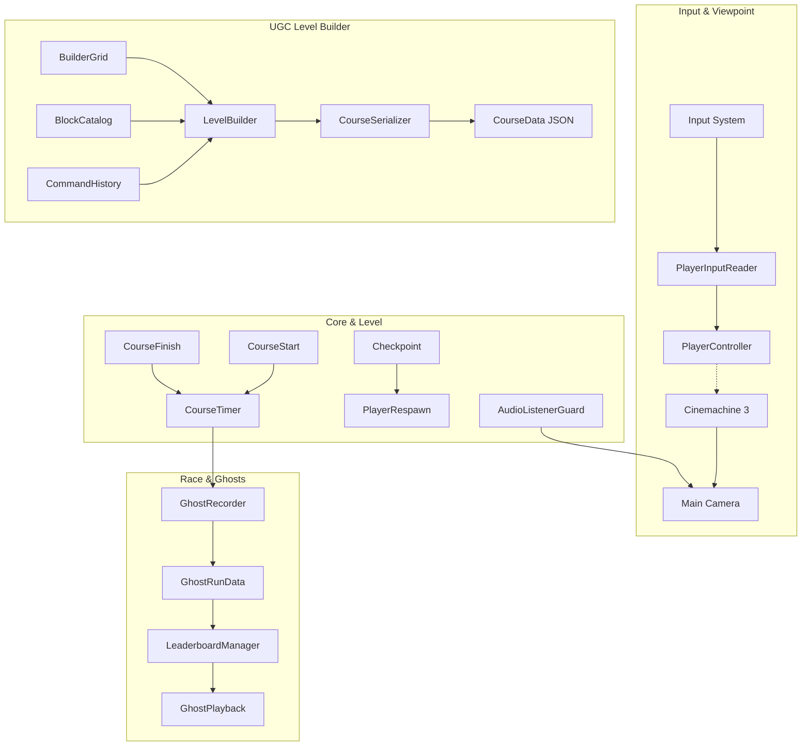

# Build & Bounce 🏃💨🏗️

> **A polished 3D platformer with runtime UGC course creation and async ghost racing.**
> *Built in Unity 6 LTS with Universal Render Pipeline (URP), C#, Unity Input System, and Cinemachine.*

---

## 🎯 1. Project Overview & The 2-Minute Recruiter Test

**Build & Bounce** was engineered as a portfolio project proving core competencies for a 3D platformer / gameplay engineering role:

1. **Tight Game Feel**: A responsive, physics-tuned 3D character controller with coyote time, jump buffering, variable jump heights, apex hang-time, double jump, snappy air dash, landing squash & stretch, and procedural audio feedback.
2. **Runtime UGC Tools**: An in-game level builder with 3D grid snapping, placement preview validity checking, runtime undo/redo via the **Command Pattern**, and roundtrip JSON course serialization with short share codes.
3. **Async Ghost Racing**: Deterministic 20 Hz fixed-tick ghost recording, translucent replay playback, and persistent local leaderboards.
4. **Production Architecture**: Strict assembly definition boundaries (`Project.Runtime`, `Project.Editor`), zero per-frame garbage collection allocations in hot paths, complete cross-platform support (Keyboard, Gamepad, Mobile Touch), and single AudioListener enforcement.

```
Core Loop: Play 🏃 → Build 🏗️ → Save 💾 → Race ⏱️ → Improve Course 🏆
```

---

## 🏗️ 2. Architecture & Systems Design



### System Decoupling Principles
- **No God Objects**: Every component has a single, well-defined responsibility.
- **Event-Driven Communication**: Systems communicate through C# events (`CourseStart.OnCourseStarted`, `CourseTimer.OnTimerFinished`, `Checkpoint.OnCheckpointActivated`) rather than runtime object searching or string lookups.
- **Assembly Isolation**: Code is partitioned into `Project.Runtime` and `Project.Editor`, enforcing strict compilation boundaries and zero editor dependencies in shipping code.

---

## 🎮 3. Cross-Platform Controls

The game is playable on **Keyboard & Mouse**, **Xbox/PlayStation Gamepads**, and **Mobile Touchscreens**.

| Action | Keyboard / Mouse | Gamepad | Mobile Touch |
|---|---|---|---|
| **Move** | `W`, `A`, `S`, `D` | Left Stick | Virtual On-Screen Thumbstick |
| **Look / Orbit** | Mouse Delta | Right Stick | Right Screen Drag |
| **Jump** | `Space` | South Button (`A` / `Cross`) | Touch Jump Button |
| **Double Jump** | `Space` (in air) | South Button (in air) | Touch Jump Button |
| **Air Dash** | `Left Shift` / `F` | West Button (`X` / `Square`) | Touch Dash Button |
| **Build / Play Toggle**| `Tab` | `Select` / `Back` / `Start` | Top-Right Toggle Button |
| **Place Block** *(Build)* | Left Mouse Click / `Space` | South Button (`A` / `Cross`) | Tap Grid Cell |
| **Rotate Block** *(Build)*| `R` | North Button (`Y`) / Right Shoulder | Rotate Button |
| **Delete Block** *(Build)*| `X` / `Delete` | West Button (`X` / `Square`) | Delete Tool |
| **Undo / Redo** *(Build)* | `Z` / `Y` | Left / Right Shoulder | Undo Button |
| **Next / Prev Block** | `E` / `Q` | D-Pad Right / D-Pad Left | Palette Selector |
| **Pause Menu** | `Escape` | `Start` / `Options` | Pause Icon |

---

## ⏱️ 4. Ghost Racing Architecture (M4)

### Determinism & Sampling
- **Tick Rate**: Player transforms are sampled at a fixed **20 Hz** inside `FixedUpdate`.
- **Zero Allocations**: Snapshots are buffered into a pre-allocated circular list (`2048` capacity), eliminating heap allocation and GC pauses during runs.
- **Interpolation**: `GhostPlayback` calculates the bounding frames and performs `Vector3.Lerp` for position and `Quaternion.Slerp` for rotation, resulting in smooth ghost replays regardless of display refresh rate.

### Offline Bot Race (No Networking Yet)
- **Local Demonstration**: `RealtimeRaceLobby` includes optional simulated racer bots for local offline testing (`_simulateRemoteRacers` defaults to `false`).

---

## 🌐 5. Course Persistence & Share Codes (UGC)

- **Local JSON Storage**: Courses save to persistent JSON files in `Application.persistentDataPath/Courses/` using their share code as the filename.
- **Short Share Codes**: Generates 6-character clean alphanumeric share codes (e.g. `BNB84X`) with collision-resistant alphabets (excluding ambiguous `0/O` and `1/I`).
- **Local Simulation**: Backend service operates in local simulation mode without requiring live external cloud dependencies.

---

## 📊 6. Performance & Architectural Goals

- **Zero GC Allocations in Hot Paths**: Pre-allocated buffers, non-allocating physics queries (`Physics.OverlapBoxNonAlloc`), and cached delegates.
- **Deterministic Physics Step**: 50 Hz `FixedUpdate` character controller execution.
- **Audio Listeners**: Automated `AudioListenerGuard` enforces exactly 1 listener.
- **Shared Materials**: Palette blocks reuse shared materials per block type to avoid runtime material instantiation.

---

## 🚀 7. Step-by-Step Editor Testing Guide

Everything can be configured and tested with one click from the top menu bar in the Unity Editor:

1. **Platformer Core & Polish (M1 & M2)**:
   - Menu: **Build & Bounce > Setup Level Greybox & Checkpoints**
   - Menu: **Build & Bounce > Setup Player & Cinemachine Camera**
   - Press **Play**: Run, double jump, dash through checkpoints to the finish pad.

2. **Level Builder UGC (M3)**:
   - Menu: **Build & Bounce > Setup Level Builder**
   - Press **Play**: Press **Tab** (or Gamepad **Select/Start**) to switch to Build Mode.
   - Place blocks, rotate with **R**, undo with **Z**, test-play with **Tab**.
   - Save your course and receive a short share code!

3. **Ghost Racing & Local Leaderboards (M4)**:
   - Menu: **Build & Bounce > Setup Ghost Racing (M4)**
   - Press **Play**: Complete a run. Your personal record and ghost will be recorded.
   - Step onto the Start pad again: race side-by-side against your **translucent ghost**!
